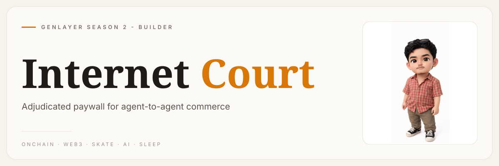
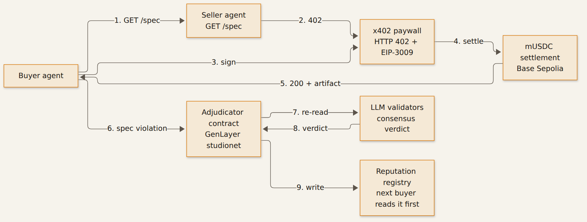

# Internet Court — Adjudicated Paywall (GenLayer × x402)



**Pay over x402. Got scammed? GenLayer’s LLM validators rule the dispute on-chain.**


An open settlement layer for **agent-to-agent commerce**: an agent pays another agent over
[x402](https://x402.org) and, when the delivery violates the published spec, the dispute is decided
**on-chain by GenLayer's LLM validators** instead of a private backend. The verdict is written back as
consensus-backed reputation that the next buyer can read before paying.

## Why

x402 makes payment easy but gives the payer no recourse: the money is pulled the moment the seller
submits the signed authorization, and the artifact can be junk. Internet Court adds the missing
enforcement rail — no escrow, no custodian, no support ticket:

1. Seller publishes a **machine-checkable spec** (`GET /spec`) before taking money.
2. Buyer pays via x402 (`EIP-3009 transferWithAuthorization`, settled on Base Sepolia).
3. Buyer checks the delivery against the spec. Violation → opens a case on the GenLayer
   intelligent contract with spec + artifact + payment reference.
4. `adjudicate()` runs **inside GenVM consensus**: every validator re-reads the same agreement and
   delivery and must agree on the verdict + quality bucket. Result: `RELEASE` / `PARTIAL_REFUND` / `REFUND`.
5. The verdict updates an on-chain reputation scoreboard. Anyone can wire it into a refund rail.

## How it works



## Live deployments

| Piece | Where |
| --- | --- |
| Adjudicator contract (GenLayer) | [`0xA799cCB52eb1345973A1fe39ad312861dd74EFb2`](https://explorer-studio.genlayer.com/address/0xA799cCB52eb1345973A1fe39ad312861dd74EFb2) — studionet |
| Settlement asset (Base Sepolia) | `0x0e6eE7BE16204641c358d8E104b7066f6A5C4b50` (demo mUSDC with EIP-3009) — tx [`0x2a1cfec9…787d6`](https://sepolia.basescan.org/tx/0x2a1cfec99d4182fe213c7ec53647cf31a0c55050c0d6f35104b3d0de0df787d6) |

On-chain proof from the last run (explorer shows `GENVM RESULT` + `CONSENSUS RESULT` per tx):

- `open_case` `0x3073e759…d50f1edf` · `adjudicate` `0x3183bf36…c7255ee2` → verdict **REFUND**, bucket `violates`
- seller reputation after the ruling: `deals 1 · refunds 1 · score 0 · unpaid_atto 100000000000000`

## Demo video

`internet_court_demo.mp4` (in this repo under `assets/`, 56 s) walks both legs end to end -
honest settlement, then a caught cheating seller - with the real on-chain verdict and reputation.

## Run it

```bash
cd repo/demo
GL_CONTRACT=0xA799cCB52eb1345973A1fe39ad312861dd74EFb2 node run_demo.mjs
```

Needs Node 18+ and `npm i` in `repo/demo/` (the only dependency is `ethers`). One command spins up an honest seller (`:7781`) and a dishonest one (`:7782`), runs an autonomous
buyer against both, and writes `evidence_<ts>.json` + `transcript_<ts>.json`:

- **leg 1** honest: `402 → sign → settle on-chain → 200` with a conforming artifact, no dispute
- **leg 2** dishonest: paid, ships junk (`ETH/JPY`, price `999999999`, epoch timestamp) → buyer detects
  three spec violations → case opened → GenLayer verdict `REFUND` → reputation updated

Re-read any case later with `node check_case.mjs <caseId>`.

## Layout

```
repo/
  contracts/escrow_adjudicator.py   # GenLayer intelligent contract (adjudicate + reputation)
  demo/x402.mjs                     # 402 challenge, EIP-3009 sign/verify/settle (dependency-light)
  demo/seller.mjs                   # paid agent service (--mode good|bad)
  demo/buyer_agent.mjs              # pays, enforces the spec, opens + adjudicates cases
  demo/genlayer.mjs                 # CLI client (views/writes, non-interactive keystore)
  demo/run_demo.mjs                 # end-to-end orchestrator + evidence writer
  demo/check_case.mjs               # re-read case + seller reputation
```

## Notes from building it

- The demo token implements EIP-3009 properly (`hex"1901"` domain prefix — an escaped-literal version
  silently breaks `ecrecover` and every settlement reverts with `auth:bad-signature`).
- Storage payloads in GenVM must be JSON strings, not `@allow_storage` dataclasses nested in maps, and
  every address-like argument needs an explicit `str()` cast before it reaches `json.dumps`.
- The settler submits the open `transferWithAuthorization` variant (the authorization is signed over
  that type); the nonce keeps it replay-proof.
- `setup_agents.mjs` / `deploy_token.mjs` read the funding wallet from `OPERATOR_KEY_FILE`
  (default `~/.config/internet-court/operator.key`) - no key is ever committed; `.keys/` is gitignored.
- `genlayer.mjs` drives the GenLayer CLI non-interactively: the keystore password is piped from
  `GL_PW_FILE` (default `~/.config/genlayer-demo/pw.txt`), so deploys and reads run headless.
